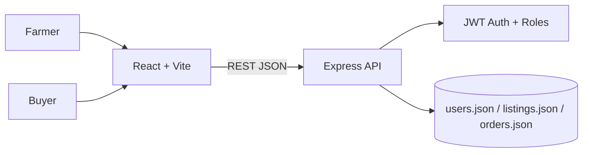

# BloomBridge — Floriculture Selling Platform

A React + Express MVP for Udupi Mallige and other floriculture growers. Includes JWT login/registration, farmer and buyer roles, flower listings, ordering, farmer confirmation/rejection/completion, and persistent JSON files.

## Architecture



## Run locally (Node.js 20+)

Terminal 1:
```bash
cd backend
cp .env.example .env
# IMPORTANT: replace JWT_SECRET in .env with a strong random secret
npm install
npm run dev
```

Terminal 2:
```bash
cd frontend
cp .env.example .env
npm install
npm run dev
```

Open http://localhost:5173. Create one farmer account and one buyer account to test the end-to-end workflow. API is at http://localhost:4000/api.

## API

| Method | Path | Access |
|---|---|---|
| POST | /api/auth/register | Public |
| POST | /api/auth/login | Public |
| GET | /api/auth/me | Signed in |
| GET | /api/listings | Public |
| POST | /api/listings | Farmer |
| GET | /api/orders | Signed in |
| POST | /api/orders | Buyer |
| PATCH | /api/orders/:id/status | Farmer (owner) |
| GET | /api/admin/summary | Admin |
| GET | /api/health | Public |

## Notes

- Users and orders are saved in `backend/data/*.json`. Passwords are bcrypt-hashed; never stored in plain text.
- New accounts can only choose farmer or buyer. Admin access requires an admin user provisioned securely outside the public registration flow; no admin bootstrap is included.
- Prices are farmer-set; the app does **not** promise guaranteed buyback, payment settlement, real-time market price verification, or legally binding contracts.
- This JSON storage implementation is for a **single Node.js process**, not production multi-instance deployments. A database transaction would be needed for robust order/stock consistency. Rejected orders restore stock; interrupted writes may require reconciliation.
- For production, add PostgreSQL, payment integration, verified buyer commitments, HTTPS, stronger validation, audit logs, automated tests, and secure token storage (HttpOnly cookies).
